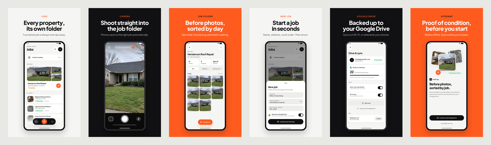

# SiteSnap

An Android app for subcontractors who need to photograph a property before starting a job.



- **Job folders.** Create a folder per job (name, address, work order #). The address field autocompletes street addresses as you type (the phone's own Geocoder, no API key needed) and has a "Use my location" button. Deleting a job asks for confirmation first, and can also move the job's Drive folder to the trash.
- **Camera.** Take photos straight into the open job folder. Zoom works like a phone's camera app: pinch with two fingers, tap the lens chips (.5 / 1× / 2 / 5 / 10, depending on the camera), or tap the active chip or drag sideways to get a ruler slider. Tap the viewfinder to focus.
- **Photo names.** Photos are named `date address number` by default, e.g. `2026-11-22 1420 Oak St 001.jpg`. In the photo viewer you can rename or delete a photo. Long-press in a job folder to select several photos and delete them together. Renames and deletes are mirrored to Drive, where deleted photos go to the trash.
- **MediaStore storage.** Photos are saved with `MediaStore` under `Pictures/SiteSnap/<Job name>/`, so they also show up in the phone's gallery. The app needs no storage permission (API 29+).
- **Google Drive sync.** Each job is mirrored to `My Drive / SiteSnap / <Job name>/`. New photos upload in the background (WorkManager), with an optional Wi-Fi-only setting.
- **In-app updates from GitHub.** On launch the app checks this repo's latest GitHub Release. If it's newer, it offers to download the APK, checks it against GitHub's SHA-256, and hands it to the Android installer.

**Design:** [Figma: SiteSnap – Android App](https://www.figma.com/design/02IX64ogIIqbAdgUf3lu1V). The current design is on the **v2** page: a warm neutral palette, ink with a safety-orange accent, Plus Jakarta Sans, borderless soft cards, photo-first job cards, a floating dock and glass camera controls. The first design is kept on the "v1 · Original" page. The Compose theme in `ui/theme/Theme.kt` uses the v2 tokens.

**Font:** Plus Jakarta Sans (`app/src/main/res/font/plus_jakarta_sans.ttf`) is bundled under the SIL Open Font License. See `licenses/PlusJakartaSans-OFL.txt`.

## Tech

| Area | Choice |
|---|---|
| UI | Jetpack Compose, Material 3, Navigation Compose |
| Camera | CameraX (`ImageCapture` writes directly to MediaStore) |
| Storage | `MediaStore.Images` with `RELATIVE_PATH`; job metadata in a small JSON file (`AppStore`) |
| Auth | Google Identity Services `AuthorizationClient`, scope `drive.file` |
| Drive | Drive REST v3 through OkHttp (multipart upload) |
| Background | WorkManager `SyncWorker` (unique, append-or-replace, exponential backoff) |

`minSdk 29`, `targetSdk 36`. The Gradle wrapper uses Gradle 9.1 (needed for JDK 25).

## Project layout

```
app/src/main/java/com/sitesnap/app/
  MainActivity.kt          navigation: welcome → jobs → job folder → camera, settings
  AppViewModel.kt          job summaries, sync status, actions
  data/                    Job/AppState models, AppStore (JSON), PhotoRepository (MediaStore)
  drive/                   DriveAuth, DriveClient (REST), DriveSync, SyncWorker
  update/                  AppUpdater (GitHub Releases check, download, PackageInstaller), InstallResultReceiver
  ui/theme, ui/components  tokens + shared components (SyncChip, JobCard…)
  ui/screens/              Welcome, Jobs (+ New job sheet), JobFolder, Camera, Settings
```

## Google Drive setup (required before Drive sync will work)

1. In [Google Cloud Console](https://console.cloud.google.com/), create a project and enable the **Google Drive API**.
2. Configure the **OAuth consent screen** and add the `.../auth/drive.file` scope. While the app is in testing, add your account as a test user.
3. Create an **OAuth client ID** of type **Android**:
   - Package name: `com.sitesnap.app`
   - SHA-1 for the **release** key (what people install from GitHub): `8D:04:94:01:9B:31:5A:C6:0E:D2:EF:EA:23:A1:E8:44:FF:B7:AB:48`
   - For debug builds from Android Studio, create a second Android client with the debug SHA-1 from `./gradlew signingReport`.
4. You don't need a client secret or `google-services.json`. Google Play services matches the app by package name and signature.

`drive.file` only gives the app access to files it creates. SiteSnap can't read anything else in the user's Drive.

While the consent screen's publishing status is **Testing**, only accounts listed as test users can sign in. Add your client's Google account there, or publish the consent screen. `drive.file` isn't a sensitive scope, so publishing doesn't need Google's full verification review.

## Build

Open the folder in Android Studio, or run:

```
./gradlew assembleDebug
```

UI tests (`app/src/androidTest/`) drive the real camera screen with a two-finger pinch and the zoom slider. Run them on an emulator or phone whose camera can zoom (the emulator's front camera can):

```
./gradlew connectedDebugAndroidTest
```

## Releases and in-app updates

Distribution is through **GitHub Releases**. Installed apps update themselves from there.

**One-time setup**

1. Set the repo in `gradle.properties` (owner/name). Builds with an empty value skip update checks.
   ```
   sitesnap.githubRepo=your-github-user/SiteSnap
   ```
2. The repo must be **public**. The app reads `api.github.com/repos/<repo>/releases/latest` without a token.
3. **Back up `signing/` somewhere safe** (password manager, encrypted drive). It holds the release keystore and its password, and it's gitignored. Android only installs an update when it's signed with the same key as the installed app. If the key is lost, every phone has to uninstall and reinstall, and that deletes the job list.

**Each release**

1. Bump `versionCode` (+1) and `versionName` in `app/build.gradle.kts`.
2. Build and publish. This needs the GitHub CLI (`gh auth login` once):
   ```
   .\release.ps1 -Publish -Notes "What changed"
   ```
   This builds `dist/SiteSnap-<version>.apk`, creates tag `v<version>`, and attaches the APK. Leave out `-Publish` to only build the APK. Releases must be normal releases. Drafts and pre-releases are ignored, because the app reads `/releases/latest`.

**What the user sees**

- **First install:** download the APK from the Releases page on the phone and open it. Android asks once to allow installs from the browser or file manager.
- **Updates:** an "Update available" card appears on the Jobs screen, and in Settings → App. The first time, Android asks the user to allow installs from SiteSnap, and the app continues by itself when they come back. Android then asks the user to confirm the update. Photos and jobs are kept.
- Play Protect may show a warning for apps installed outside the Play Store. The user can choose "Install anyway".

**Testing updates locally:** build with `-Psitesnap.updateApiBase=http://10.0.2.2:8765` and serve a fake `repos/<repo>/releases/latest` JSON plus the APK from your PC. Plain HTTP is only allowed when `updateApiBase` starts with `http://`.

## Store screenshots

`store/screenshots/` holds six 1080×1920 Play Store-style screenshots. Regenerate them with `python store/make_screenshots.py`. Raw emulator captures of the demo data live in `store/raw/`. The camera image uses the app's real camera UI with a job-site photo in place of the emulator's test scene. The same layouts are also on the "Play Store screenshots" page in Figma.

The app icon is an adaptive vector: a house with a camera lens for a window, on a safety-orange gradient (`res/drawable/ic_launcher_*.xml`). It includes a monochrome layer for themed icons. `python store/make_icon.py` renders the 512×512 store icon (`store/icon-512.png`).
